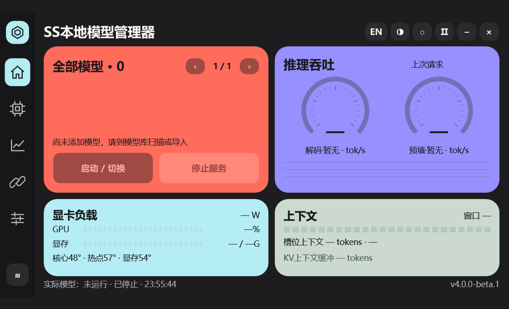
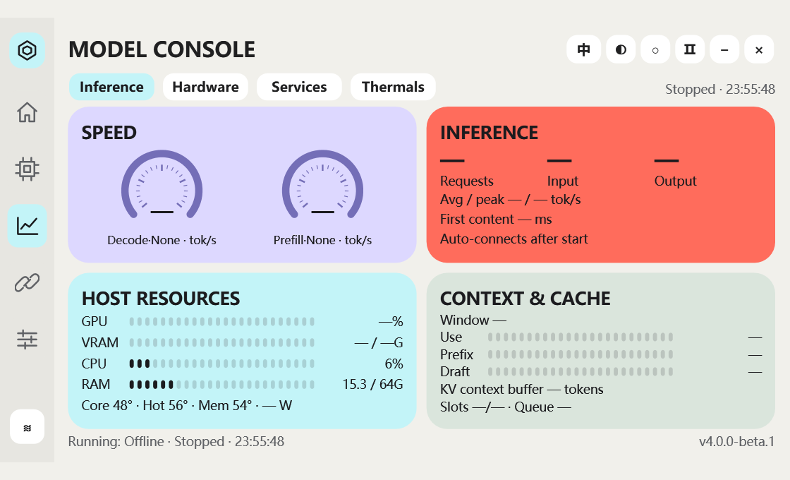
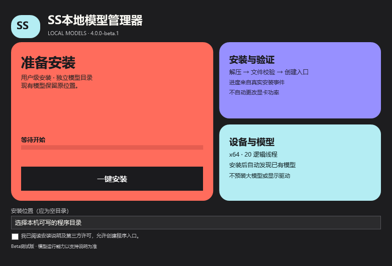

# SS本地模型管理器

面向 Windows 的本地 GGUF 模型管理、运行监控和参数配置工具。采用彩色卡片、仪表图表、深浅主题、中英文和等比缩放。

> **4.0.0-beta.1 为 CPU 测试版，不是完整 GPU 正式版。**
> 安装包是否已经上架，请以 [Releases](https://github.com/sooyings/ss-local-model-manager/releases) 中实际存在的附件为准。源码 ZIP 不是安装包。

## 下载与安装

1. 打开 [Releases](https://github.com/sooyings/ss-local-model-manager/releases)，下载 **SSLocalModelManager-4.0.0-beta.1-win-x64-Setup.exe**。
2. 双击，确认安装位置与说明，点击“一键安装”。程序按真实文件部署事件显示进度。
3. 完成后打开管理器；首次启动会扫描常见模型目录，也可以在模型库点击“扫描”或“导入 GGUF”。
4. 分片模型选择第一片，并保持全部分片齐全。已有权重保留原位置，不会复制进程序目录。
5. 选择兼容的模型，点击“启动 / 切换”。接口页可复制实际服务地址及模型 ID。

安装包包含 .NET 桌面运行时和 CPU 引擎，不要求另装 Python、Git、开发 SDK 或 AI 工具，也不预装大模型。

**系统要求：** Windows 11 x64、支持 AVX2 的 x64 CPU；内存须容纳模型、上下文缓存及系统余量。本测试版按 CPU 推理验证，不需要 NVIDIA 显卡。ARM64 不在本批支持范围。安装包尚未做发布者数字签名，可使用 Release 附件中的 SHA256SUMS.txt 核对文件。

### 无人值守安装

在安装包所在目录运行 PowerShell：

~~~powershell
.\SSLocalModelManager-4.0.0-beta.1-win-x64-Setup.exe --unattended --accept-license --no-icons --dir "$env:LOCALAPPDATA\Programs\SSLocalModelManager" --report "$env:TEMP\SS-install-result.json"
~~~

目标必须为空的可写目录。默认是当前用户安装，不自动修改驱动、显卡功率或其他模型软件。结果报告区分“程序已安装”与“模型尚未验证”。

**当前不支持覆盖升级或修复安装。** 已有测试版应先正常卸载程序，再安装；外部模型和用户数据保留。不要把程序安装到模型权重目录。

## 本批功能与边界

| 功能 | 当前状态 |
|---|---|
| GGUF 模型发现与导入 | 常见目录扫描、文件头及分片检查、原地引用、模型分页、双击修改显示名 |
| 受管 CPU 推理 | 单服务启停、空闲模型切换、重启；忙碌时拒绝停止或切换 |
| 监控 | 推理、硬件、服务、温度子页；缺失指标显示未知 |
| 上下文 / KV | 读取当前引擎日志中的真实分配值，并校验会话、进程、模型和日志偏移；分配值不等于动态已用字节 |
| 界面 | 深浅主题、中英文、等比缩放、图表和动效 |
| 运行参数 | CPU 后端实际接入的 5 项采样参数及线程数；保存后重启应用，有范围检查、指纹和备份 |
| 调优数据库 | 5 个模型、40 项带来源的参考种子及评估模块；**尚未接入本批参数页，建议值显示待评估** |
| NVIDIA 监控 / 功率 | 界面与保守能力检查保留；跨设备能力未验收，缺失传感器或不满足条件时不可应用；不自动调功率 |
| Strata、CUDA / GPU 加速、视觉 | **尚未完成本次独立发行移植** |
| 习惯学习、自动实测调优、覆盖升级、代码签名 | **尚未完成** |

这不是此前完整功能方案的最终交付。不能把 CPU 测试版对小模型的验收，推断成所有大模型、量化、引擎和硬件都已验证。

## 已完成的验收

在 GitHub 的独立 Windows 环境中完成：

- 123 项路径隔离、模型发现、归属、恢复、请求闸门、流式转发、KV 解析、调优规则和安装协议检查。
- 真实静默安装与安装入口版本检查。
- Qwen3-0.6B Q8_0 的真实 CPU 对话及 SSE 流式调用。
- 4K 上下文配置下读取到 **448 MiB CPU KV 分配**；这是该测试组合的值，其他模型会不同。
- 5 个页面和 4 个监控子页实际渲染。
- 无效目标不停止原服务；忙时拒切并保留原引擎；空闲切换与重启使用新会话。
- 卸载后外部模型文件 SHA256 和用户注册表保留。

测试权重仅在一次性测试环境使用，不随安装包发布。每个 Release 同附 verification.json 和 SHA256SUMS.txt，具体范围以对应报告为准。

## 数据与共存

- 默认本地接口为 **http://127.0.0.1:17881/v1**，只监听本机。
- 默认用户数据位于 **%LOCALAPPDATA%\SSLocalModelManager**，与程序安装目录分开。
- 常见扫描位置包括本机 Models / LLM / MODLE、Hugging Face 和 LM Studio 默认目录；自定义位置请使用导入。符号链接模型和未支持的架构可能需要额外处理。
- 如果其他软件正在运行推理，本测试版会拒绝重复启动。请先在原软件中停止其模型；不会按同名进程或端口强制结束外部服务。
- 没有默认云端兜底，也不上传聊天正文、知识库内容、账号或密钥；调优不会自动覆盖当前参数。
- 卸载程序保留外部权重和用户配置；删除模型或用户数据不属于普通卸载流程。

## 截图

以下为实际开发构建界面，使用空的隔离模型库。横线表示未启动模型或设备尚未提供该指标；安装图为安装前端的准备状态。

## 构建与许可

发行源码与作者现用控制台分开维护。构建脚本在 scripts/，Windows 云端检查在 .github/workflows/windows.yml。CPU 引擎来自官方 llama.cpp 固定提交 5320c87ff0d994845b44ce7976f10055ec697447，关闭外部 OpenSSL 依赖并进行独立运行检查。

第三方许可随包保存在 third-party/，llama.cpp 及其依赖保留各自版权和许可。本仓库尚未选择自有源码的开源许可证，公开可见不代表任意修改再分发授权。
